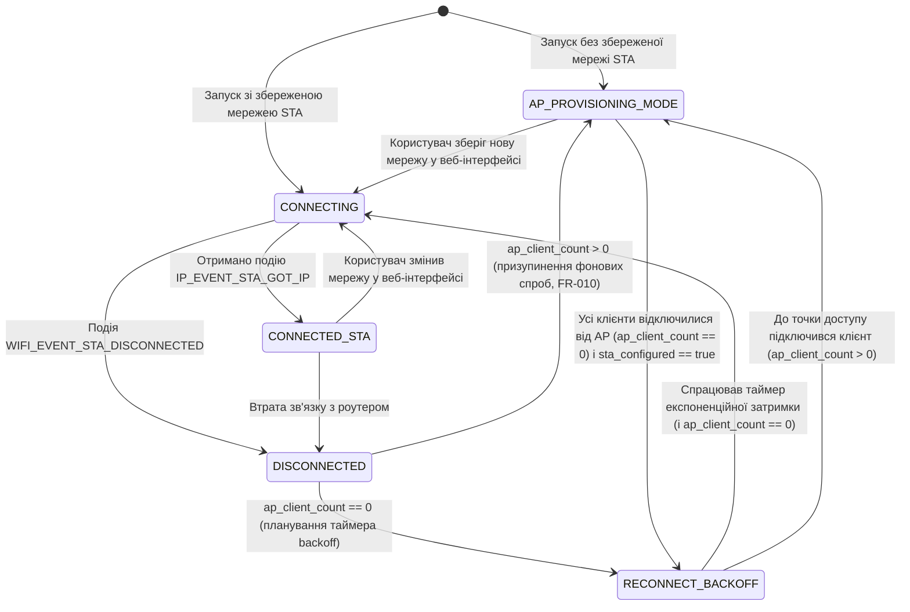

# Phase 1 Data Model: Суміщений режим Wi-Fi (AP+STA) та вбудована веб-сторінка налаштування

**Feature**: `001-wifi-apsta-web-config`  
**Date**: 2026-11-10

---

## 1. Сутність збереженої конфігурації (`wifi_stored_config_t`)

Представляє конфігурацію, що зберігається у енергонезалежній пам'яті NVS (простір імен `"wifi_cfg"`).

| Поле | Тип C | NVS Ключ | Обмеження та валідація | Значення за замовчуванням |
|------|-------|----------|------------------------|---------------------------|
| `schema_version` | `uint8_t` | `"schema_ver"` | Обов'язкове, рівне `1` (для міграції схем) | `1` |
| `sta_configured` | `bool` (`uint8_t`) | `"sta_set"` | `0` (не налаштовано) або `1` (налаштовано) | `false` (`0`) |
| `sta_ssid` | `char[33]` | `"sta_ssid"` | Якщо `sta_configured == true`: довжина `1..32` байти, нуль-термінований рядок (`FR-006`) | `""` |
| `sta_password` | `char[65]` | `"sta_pass"` | Довжина `0` (відкрита мережа) або `8..63` друкованих ASCII символів (`0x20..0x7E`), нуль-термінований (`FR-006`) | `""` |
| `ap_password` | `char[65]` | `"ap_pass"` | Довжина `8..63` друкованих ASCII символів (`0x20..0x7E`), нуль-термінований (`FR-002`, `FR-006`) | `"weather1"` |

> **Примітка щодо SSID точки доступу**: Назва точки доступу зафіксована константою `WIFI_AP_DEFAULT_SSID = "ESP Weather Clock"` (`FR-002`) і не змінюється користувачем.

---

## 2. Сутність операційного стану мережі (`wifi_runtime_status_t`)

Описує поточний стан обох інтерфейсів (`AP` та `STA`), захищений м'ютексом FreeRTOS для безпечного читання з HTTP-обробників та головного циклу.

| Поле | Тип C | Опис |
|------|-------|------|
| `fsm_state` | `wifi_fsm_state_t` | Поточний стан скінченного автомата Wi-Fi |
| `sta_connected` | `bool` | Чи встановлено з'єднання з роутером та отримано IP |
| `sta_ssid` | `char[33]` | Назва поточної (або цільової) клієнтської мережі |
| `sta_ip` | `char[16]` | Поточна IPv4-адреса клієнта в локальній мережі (наприклад, `"192.168.1.45"` або `"0.0.0.0"`) |
| `sta_rssi` | `int8_t` | Рівень сигналу роутера в dBm (наприклад, `-58`, або `0` при відключенні) |
| `last_error_reason` | `uint8_t` | Код останньої причини відключення Wi-Fi (для виведення зрозумілого повідомлення у веб-інтерфейсі) |
| `retry_count` | `uint16_t` | Лічильник поточних спроб перепідключення STA |
| `ap_ssid` | `char[33]` | Фіксовано `"ESP Weather Clock"` |
| `ap_ip` | `char[16]` | Статична IPv4-адреса точки доступу (`"192.168.4.1"`) |
| `ap_client_count` | `uint8_t` | Кількість клієнтів, підключених до точки доступу на даний момент (`0..4`) |
| `ap_channel` | `uint8_t` | Поточний радіоканал (`1..13`) |

---

## 3. Сутність елемента сканування Wi-Fi (`wifi_scan_item_t`)

Використовується для формування списку доступних мереж на веб-сторінці (`FR-005`). Статичний масив до `MAX_SCAN_RESULTS = 16` записів.

| Поле | Тип C | Опис |
|------|-------|------|
| `ssid` | `char[33]` | Назва знайденої мережі (пропускаються приховані мережі з порожнім SSID) |
| `rssi` | `int8_t` | Рівень сигналу в dBm |
| `channel` | `uint8_t` | Номер каналу (`1..13`) |
| `authmode` | `uint8_t` | Тип захисту (`OPEN`, `WPA2_PSK`, `WPA3_PSK` тощо) |

---

## 4. Сутність системної діагностики (`system_health_t`)

Використовується для діагностичного ендпоінту `/api/status` згідно з `FR-011` та Principle V Конституції.

| Поле | Тип C | Опис |
|------|-------|------|
| `uptime_sec` | `uint64_t` | Час безперервної роботи з моменту запуску в секундах |
| `free_heap_bytes` | `uint32_t` | Поточний обсяг вільної купи SRAM у байтах |
| `min_free_heap_bytes` | `uint32_t` | Мінімальний зафіксований обсяг вільної купи (watermark) у байтах |
| `mdns_hostname` | `char[32]` | Локальне ім'я mDNS (`"weather-clock.local"`) |

---

## 5. Скінченний автомат станів Wi-Fi (`wifi_fsm_state_t`)

Пристрій завжди працює в радіорежимі `WIFI_MODE_APSTA` (точка доступу `"ESP Weather Clock"` завжди активна). Скінченний автомат керує життєвим циклом клієнтського з'єднання (`STA`) та його взаємодією з активними сесіями на точці доступу:

### Правила переходів (State Invariants):
1. **Захист сесії точки доступу (`FR-010`)**: Якщо `ap_client_count > 0`, фоновий таймер `RECONNECT_BACKOFF` зупиняється, щоб радіомодуль не стрибав по каналах під час роботи користувача з веб-сторінкою.
2. **Явна дія користувача (`FR-008`)**: Натискання кнопки «Підключитися / Зберегти» у веб-інтерфейсі завжди переводить автомат у стан `CONNECTING` незалежно від значення `ap_client_count`.
3. **Експоненційна затримка (`RECONNECT_BACKOFF`)**: Інтервал між фоновими спробами зростає за формулою $\min(2^{\text{retry}} \text{ с}, 60 \text{ с})$ (`2s → 4s → 8s → 16s → 32s → 60s`).
4. **Апаратне скидання (`FR-012`)**: Утримання кнопки `BOOT` (`GPIO9`) протягом $\ge 3$ секунд стирає збережені облікові дані, відновлює пароль точки доступу `"weather1"` та переводить систему в `AP_PROVISIONING_MODE`.
