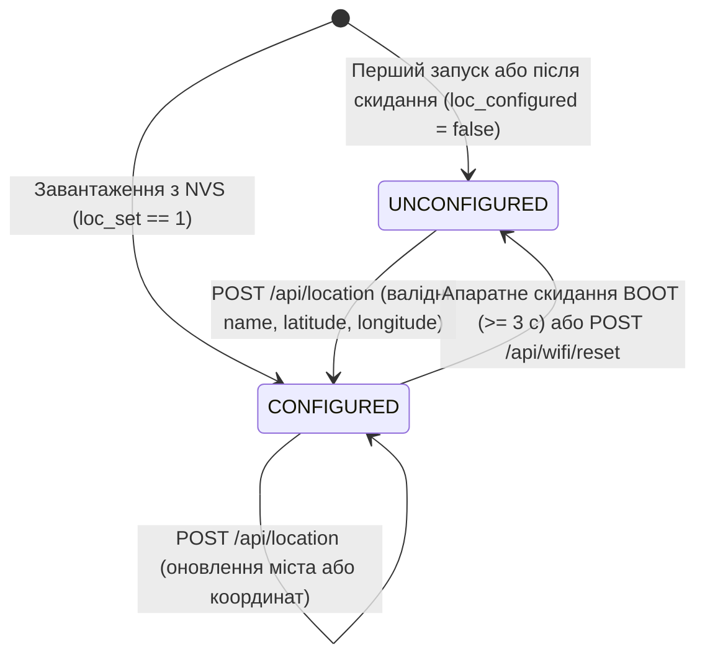

# Phase 1 Data Model: Поля налаштування поточного місця знаходження на сторінці підключення

**Feature**: `002-location-config`  
**Date**: 2026-11-18

---

## 1. Сутність налаштувань місця знаходження (`location_config_t` / розширення `wifi_stored_config_t`)

Представляє параметри поточного місця знаходження, які зберігаються у просторі імен NVS `"wifi_cfg"` (схема версії `CONFIG_STORE_SCHEMA_VERSION = 2`).

### Поля у C-структурі та NVS

| Поле C | Тип C | NVS Ключ | Тип NVS | Обмеження та правила валідації (`FR-004`) | Значення за замовчуванням |
| ------ | ----- | -------- | ------- | ----------------------------------------- | ------------------------- |
| `loc_configured` | `bool` | `"loc_set"` | `uint8_t` | `0` (не налаштовано) або `1` (налаштовано користувачем) | `false` (`0`) |
| `loc_name` | `char[65]` | `"loc_name"` | `str` | Якщо `loc_configured == true`: довжина `1..64` байти UTF-8 (`LOC_NAME_MAX_LEN = 64`), без керівних символів (`< 0x20`), не складається лише з пробілів | `""` |
| `latitude` | `double` | `"loc_lat_u6"` | `int32_t` | Скінченне число (`isfinite`), діапазон `[-90.0, 90.0]` градусів; у NVS зберігається як `round(latitude * 1e6)` у діапазоні `[-90000000, 90000000]` | `0.0` (`0`) |
| `longitude` | `double` | `"loc_lon_u6"` | `int32_t` | Скінченне число (`isfinite`), діапазон `[-180.0, 180.0]` градусів; у NVS зберігається як `round(longitude * 1e6)` у діапазоні `[-180000000, 180000000]` | `0.0` (`0`) |

### Повна структура `wifi_stored_config_t` (Схема v2)

```c
#define CONFIG_STORE_SCHEMA_VERSION     2U
#define LOC_NAME_MAX_LEN                64U
#define LOC_LAT_MIN                     (-90.0)
#define LOC_LAT_MAX                     (90.0)
#define LOC_LON_MIN                     (-180.0)
#define LOC_LON_MAX                     (180.0)

typedef struct {
    uint8_t schema_version;                     /**< Версія схеми (2) */
    bool sta_configured;                        /**< Наявність збереженої мережі STA */
    char sta_ssid[WIFI_SSID_MAX_LEN + 1U];      /**< SSID роутера (1..32 байти) */
    char sta_password[WIFI_PASS_MAX_LEN + 1U];  /**< Пароль роутера (0 або 8..63 символи) */
    char ap_password[WIFI_PASS_MAX_LEN + 1U];   /**< Пароль точки доступу (8..63 символи, за замовчуванням "weather1") */
    bool loc_configured;                        /**< Чи налаштовано поточне місце знаходження */
    char loc_name[LOC_NAME_MAX_LEN + 1U];       /**< Назва населеного пункту України (1..64 байти UTF-8) */
    double latitude;                            /**< Географічна широта [-90.0 .. 90.0] */
    double longitude;                           /**< Географічна довгота [-180.0 .. 180.0] */
} wifi_stored_config_t;
```

---

## 2. Елемент вбудованого довідника населених пунктів України (Frontend Static Dataset)

Використовується у клієнтському скрипті `app.js` (скомпільованому у Flash через `EMBED_TXTFILES`) для випадаючого списку міст/населених пунктів України (`FR-001`, `FR-002`, `FR-009`).

| Поле | Тип | Опис | Приклад |
| ---- | --- | ---- | ------- |
| `name` | `string` | Назва населеного пункту України (українською мовою, до 64 байтів UTF-8) | `"Київ"`, `"Львів"`, `"Івано-Франківськ"` |
| `lat` | `number` | Географічна широта центру населеного пункту (4 знаки після коми) | `50.4501` |
| `lon` | `number` | Географічна довгота центру населеного пункту (4 знаки після коми) | `30.5234` |

> **Охоплення вбудованого списку**: Усі обласні центри України, м. Київ, м. Севастополь, м. Сімферополь та основні великі міста України, а також спеціальна опція **«Інший населений пункт (ввести вручну)»**, яка дозволяє користувачу ввести будь-яке місто/селище/село України та його координати.

---

## 3. Життєвий цикл та переходи стану налаштувань місця знаходження



### Інваріанти цілісності даних:
1. **Незалежність від мережевого стану (`FR-007`)**: Перехід `UNCONFIGURED → CONFIGURED` або `CONFIGURED → CONFIGURED` виконується без перезапуску чи перепідключення інтерфейсів `STA`/`AP`.
2. **Захист при помилці валідації (`FR-005`)**: Якщо запит `POST /api/location` містить порожнє ім'я, ім'я довше 64 байтів або координати поза межами `[-90..90]` / `[-180..180]`, стан у NVS та RAM залишається незмінним.
3. **Міграція схеми (`schema_ver = 1 → 2`)**: При читанні NVS із `schema_ver == 1` поля `sta_*` та `ap_password` зберігаються, а поля локації ініціалізуються станом `UNCONFIGURED` (`loc_configured = false`, `loc_name = ""`, `latitude = 0.0`, `longitude = 0.0`).
4. **Повне заводське скидання (`FR-010`)**: Функція `config_store_factory_reset()` скидає одночасно мережеві параметри та переводить локацію у стан `UNCONFIGURED`.
